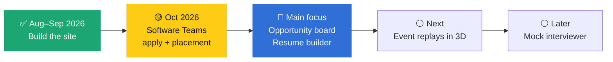
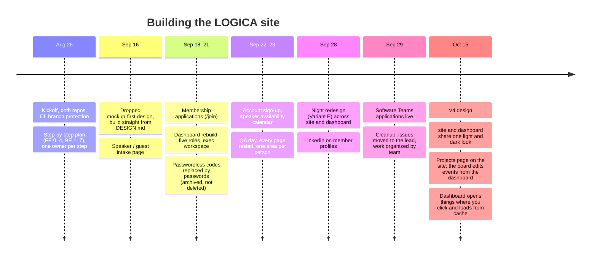

# Roadmap

> **Owner:** [@nicolasrufino](https://github.com/nicolasrufino) · **Last reviewed:** Oct 15, 2026 · **Audience:** Members and recruiters · **Type:** Plan

LOGICA @ UIC is building two things: **the club site** (live) and **four products for UIC students** (one team each, starting once teams are placed). The public overview is on [logicauic.org/projects](https://logicauic.org/projects).

## Now: October 2026

| What | Where | Status |
|---|---|---|
| Members apply to Software Teams from the Projects page | [logicauic.org/projects](https://logicauic.org/projects) · frontend#91 · backend#64 | 🟢 Open |
| Review applications, interviews, team placement | exec dashboard → Applications | 🟡 In progress |
| Team kickoffs | TBD · issues labeled `team: …` | ⚪ After placement |

Placement rule: **people who have contributed the most get priority**, then the application and a short interview. Details: [Software Teams: Fall 2026](docs/guides/software-teams-fall-2026.md).

## Next: the products

Each product has a team page with scope, first milestone and roles.

| Product | Team page | Label | Priority |
|---|---|---|---|
| Opportunity board: scrapers, feed by class year, tracker | [projects/opportunity-board/](projects/opportunity-board/) | `team: opportunity-board` | 🔵 Main focus |
| Resume builder: your own AI over MCP, one proven template | [projects/resume-builder/](projects/resume-builder/) | `team: resume-builder` | 🔵 Main focus |
| Event replays in 3D: computer vision, faces blurred | [projects/event-replays/](projects/event-replays/) | `team: event-replays` | ⚪ Next |
| Mock interviewer: interview practice with feedback via MCP (text first) | [projects/mock-interviewer/](projects/mock-interviewer/) | `team: mock-interviewer` | ⚪ Later |
| The site itself: upkeep | [projects/site/](projects/site/) | `team: site` | Ongoing |

Every product starts with a **two-week spike**: prove the hard part works on one laptop before it touches the site.

### Dates

**TBD.** No team has started yet. Kickoffs, demo days and releases are set as each team starts, and get added here as we move on. Demo writeups, slides and retros land in each `projects/<team>/` folder. The practices behind it: [How we run projects](docs/how-we-run-projects/README.md).

## Before: how we got here (Aug–Sep 2026)

**What changed and why**

| Before | Now | Why |
|---|---|---|
| Numbered steps, one person per step | One team per product | Steps finished; products need small teams with clear owners |
| Mockup first, then code | The V4 design in [`frontend/design/logica.pen`](https://github.com/uic-logica/frontend/tree/main/design) + DESIGN.md is the spec (it replaced the night design on Oct 15) | Waiting on mockups stalled pages for days |
| Passwordless email codes | Passwords, @uic.edu sign-up | Code delivery and callbacks needed more work behind the proxy; paused and kept in `backend/archive/passwordless`, not deleted |
| Issues spread across everyone | All open issues owned by the lead until teams are placed | A clean start; teams pick up labeled issues after placement |

## Open site issues

| Issue | What | Label |
|---|---|---|
| backend#41 | Delete the seeded `qa.*` accounts before launch | `team: site` |
| backend#43 | Connect Google Drive for exec Documents | `team: site` |
| frontend#54 | Dashboard UI pass: ask less of the user | `team: site` |
| frontend#9 | Member spotlight | `team: site` |
