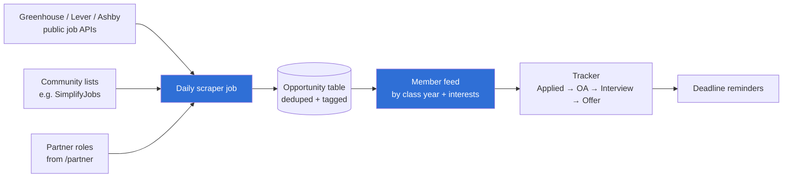

# Opportunity board

> **Owner:** [@nicolasrufino](https://github.com/nicolasrufino) · **Last reviewed:** Sep 29, 2026 · **Audience:** Members and recruiters · **Type:** Project page

**Label:** `team: opportunity-board` · **Priority:** main focus

Every internship and new-grad role worth applying to, always current, filtered to what each member can actually get — plus a tracker for every application.

| Milestone | Done when | Area |
|---|---|---|
| 1. Spike | One scraper pulls one company's board into a local table, deduped | Backend |
| 2. Data model | `Opportunity` with tags (year, field, location, sponsorship, deadline) + migration | Backend |
| 3. Daily job | Scheduled job refreshes all sources; closed roles drop off | Backend |
| 4. Feed | Dashboard tab shows roles matched to the member's year | Frontend |
| 5. Tracker | Members move applications through stages; reminders fire before deadlines | Full-stack |

**Rules:** public APIs and lists only — no scraping sites whose terms forbid it (LinkedIn, Indeed, Handshake).
**You learn:** scraping, scheduled jobs, data pipelines, search.

## Timeline

**TBD.** The team hasn't started yet. Dates are set once people are placed and the team kicks off, and get added here as we move on.

## Artifacts

| File | What | Status |
|---|---|---|
| [okrs.md](okrs.md) | Objectives and key results, graded 0–1 | Due at kickoff |
| [design-doc.md](design-doc.md) | 1–3 page design doc | See timeline |
| [research.md](research.md) | Prior art, source policy and tagging rules | Reviewed Oct 1 |
| [build-plan.md](build-plan.md) | Architecture, schedule, backlog, risks and tests | Ready for issues |
| [status/](status/) | Weekly snippet every Monday | Once the team starts |
| [launch-checklist.md](launch-checklist.md) | Must pass before the public release | Before the demo |
| [demos/](demos/) | Demo day writeup, slides, video | TBD |
| [retro.md](retro.md) | Blameless retro and findings | After the demo |
