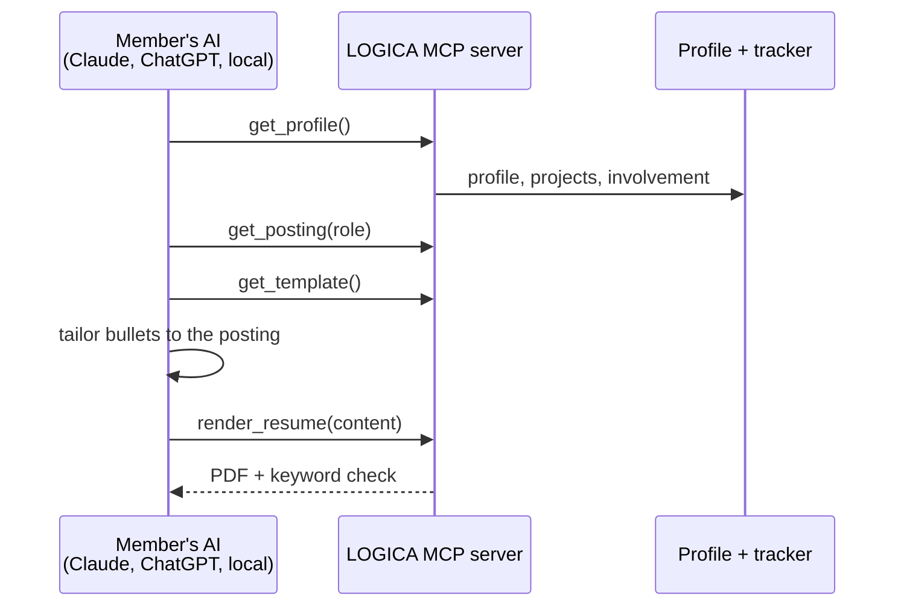

# Resume builder

> **Owner:** [@nicolasrufino](https://github.com/nicolasrufino) · **Last reviewed:** Oct 1, 2026 · **Audience:** Members and recruiters · **Type:** Project page

**Label:** `team: resume-builder` · **Priority:** main focus

A resume tailored to each posting, from one proven template. **Members' own AI does the writing through our MCP tools**, so the club pays for no tokens.

| Milestone | Done when | Area |
|---|---|---|
| 1. Spike | One template renders to PDF from a JSON résumé | Backend |
| 2. MCP tools | `get_profile`, `get_posting`, `get_template`, `render_resume` work from a real AI client | Backend |
| 3. Keyword check | Plain code lists posting terms missing from the resume (no AI) | Backend |
| 4. Resume page | Preview, versions per application, download | Frontend |

**Template:** one single-page layout recruiters already trust; bullets as "did X, measured by Y, by doing Z". No custom designs.
**You learn:** MCP servers, tool design for AI agents, PDF rendering.

## Timeline

**TBD.** The team hasn't started yet. Dates are set once people are placed and the team kicks off, and get added here as we move on.

## Artifacts

| File | What | Status |
|---|---|---|
| [research.md](research.md) | LinkedIn limits, ATS formats, rendering and tailoring research | Complete Oct 1 |
| [build-plan.md](build-plan.md) | Architecture, privacy, schedule, backlog and tests | Ready for kickoff |
| [okrs.md](okrs.md) | Objectives and key results, graded 0–1 | Due at kickoff |
| [design-doc.md](design-doc.md) | 1–3 page design doc | See timeline |
| [status/](status/) | Weekly snippet every Monday | Once the team starts |
| [launch-checklist.md](launch-checklist.md) | Must pass before the public release | Before the demo |
| [demos/](demos/) | Demo day writeup, slides, video | TBD |
| [retro.md](retro.md) | Blameless retro and findings | After the demo |

**Decision:** LinkedIn supplies the existing copied photo only; member-confirmed structured data supplies experience because self-serve OIDC does not expose work history.
